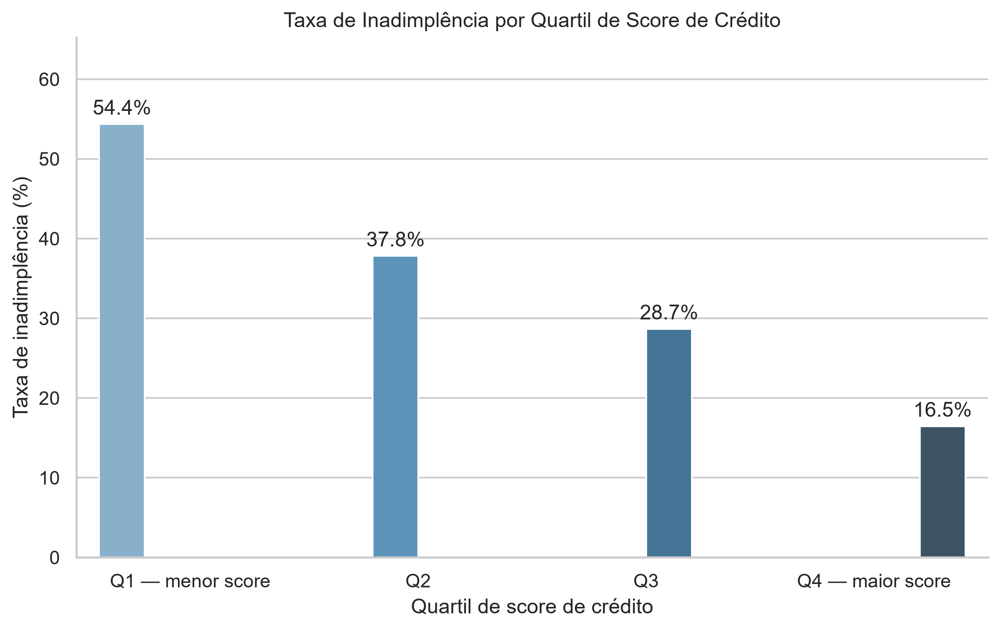
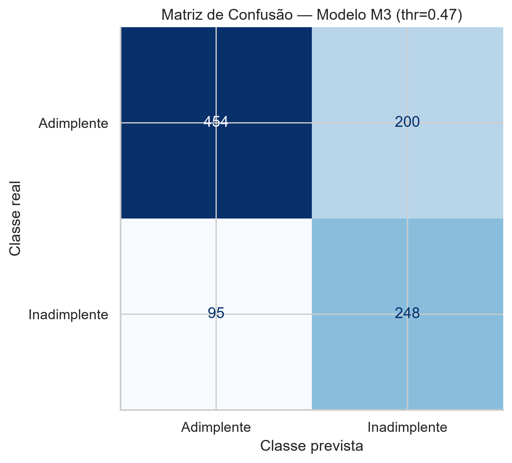
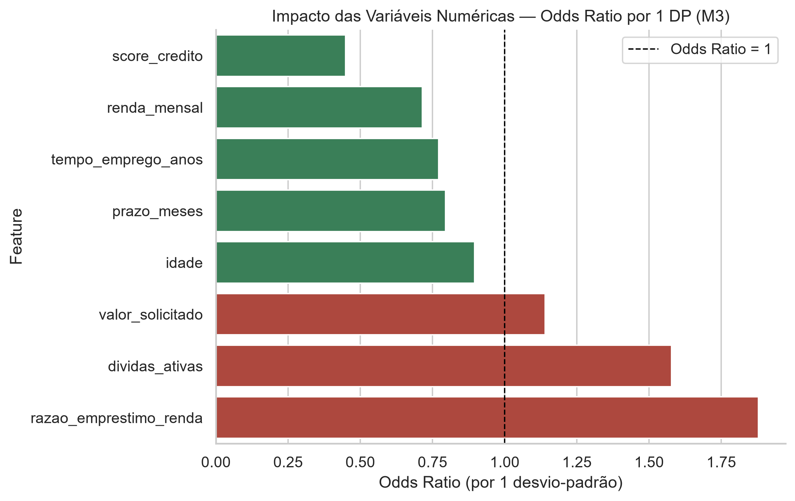
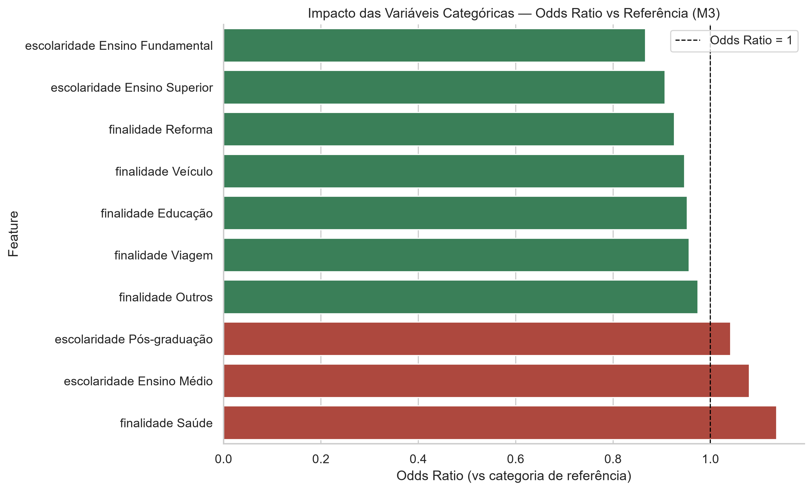

# Roteiro de apresentação — Análise de Crédito

> **Nota:** As imagens referenciam arquivos em `imagens/`. Para visualizar corretamente, abra este arquivo a partir do diretório `desafios/analise-credito/` ou use um visualizador Markdown com base URL configurada.

---

## Slide 1 — Problema e objetivo

- CredAIR possui histórico de propostas de empréstimo.
- Objetivo: identificar propostas com maior risco de inadimplência.
- Resposta: `inadimplente`, classificação binária.

**Speaker notes:** "A CredAIR é uma financeira fictícia que quer usar seu histórico para prever quais novas propostas têm maior risco de inadimplência. É um problema clássico de classificação binária supervisionada."

---

## Slide 2 — Dados disponíveis

- 5.000 propostas brutas.
- Perfil do solicitante, renda, score, pedido, prazo, finalidade e dívidas.
- Dados sintéticos e educacionais.

**Speaker notes:** "Temos 5.000 registros com 11 variáveis: idade, estado, escolaridade, renda, tempo de emprego, score de crédito, valor solicitado, prazo, finalidade, dívidas ativas e a variável alvo inadimplente. Importante: dados sintéticos, não usar em produção real."

---

## Slide 3 — Qualidade dos dados

- 19 duplicatas exatas adicionais.
- 15 idades codificadas dez vezes acima do plausível (ex: 350 anos → corrigido para 35).
- 7 tempos de emprego acima do domínio observado (marcados como ausentes).
- Estados com espaços extras: 85 representações reduzidas para 27 estados padronizados.
- Não havia ausências no arquivo bruto.

**Speaker notes:** "O arquivo bruto não tinha NaNs, mas tinha problemas de qualidade: duplicatas, idades com erro de digitação (multiplicadas por 10), tempos de emprego implausíveis (>30 anos) e inconsistências textuais nos estados. Tratamos tudo de forma determinística e auditável."

---

## Slide 4 — Tratamento e atributo derivado

- Padronização textual (strip em categorias).
- Correção das idades identificadas (divisão por 10 quando >100).
- Tempos inválidos marcados como ausentes → imputados somente no treino (pipeline).
- Remoção de duplicatas exatas.
- Criação de `razao_emprestimo_renda = valor_solicitado / renda_mensal`.

**Speaker notes:** "A variável derivada `razao_emprestimo_renda` captura o comprometimento relativo da renda — é mais informativa que o valor absoluto do empréstimo. A imputação do tempo de emprego ocorre só no treino via pipeline, evitando data leakage."

---

## Slide 5 — Evidências exploratórias

- Inadimplência no quartil inferior de score: 54.4%; no superior: 16.5%.
- Quartil inferior de renda: 50.8%; superior: 22.0%.
- Mais de três dívidas ativas: 48.2%.
- Maior quartil da razão empréstimo/renda: 54.6%.

**Speaker notes:** "Quatro achados principais: score de crédito é o preditor mais forte (54% vs 16%), renda baixa concentra risco, múltiplas dívidas dobram a inadimplência, e a razão empréstimo/renda (nossa variável derivada) mostra o mesmo padrão do score — confirmando sua validade."

---

## Slide 6 — Preparação e comparação

- Divisão estratificada 80/20 (random_state=42).
- Imputação (mediana), escala (StandardScaler) e one-hot dentro de pipeline — **zero leakage**.
- Baseline (classe majoritária), M1 (originais), M2 (+ razão), M3 (sem estado + razão).
- Seleção pela PR-AUC média em validação cruzada estratificada 5-fold.

**Speaker notes:** "Pipeline garante que nada do teste vaza pro treino. Comparamos 3 variantes da Regressão Logística + baseline. PR-AUC é a métrica certa pra desbalanceamento 34/66. M3 vence na CV."

---

## Slide 7 — Resultados

- Baseline: ROC-AUC 0.500 e PR-AUC 0.344.
- M3 selecionado: ROC-AUC 0.771 e PR-AUC 0.648 no teste.
- **Com threshold otimizado via CV (0.47): Recall 0.723, F1 0.627, Balanced Accuracy 0.709.**
- Threshold padrão 0.5: Recall 0.449, Precisão 0.658.

**Speaker notes:** "O threshold 0.5 padrão subestima o recall. Otimizando no CV (maximiza F1), achamos 0.47. No teste: capturamos 72% dos inadimplentes (vs 45% com 0.5), F1 sobe de 0.53 pra 0.63. Trade-off: precisão cai de 66% pra 55%, mas captura muito mais risco real."

---

## Slide 8 — Interpretação

- **Numéricas (por 1 DP):** Razão empréstimo/renda (OR 1.88) e dívidas ativas (OR 1.58) ↑ risco. Score (OR 0.45), renda (OR 0.72), tempo emprego (OR 0.77) ↓ risco.
- **Categóricas (vs referência):** Finalidade saúde e escolaridade ensino médio mostram OR > 1; ensino fundamental e superior mostram OR < 1.
- `estado` removido: 27 categorias, proxy geográfico, risco de overfitting.

**Speaker notes:** "Separam interpretação: numéricas = efeito por desvio-padrão (padronizadas); categóricas = vs categoria de referência. Top drivers de risco: comprometimento da renda e dívidas ativas. Top protetores: score, renda, estabilidade emprego. Estado removido por cautela regulatória."

---

## Slide 9 — Limitações

- Dados sintéticos — sem garantia de validade externa.
- Sem histórico temporal — não avalia estabilidade/drift.
- Threshold otimizado por F1 no CV não incorpora custos reais de FP/FN.
- Associação não implica causalidade.
- Variáveis demográficas/geográficas podem atuar como proxies sensíveis.

**Speaker notes:** "Quatro limitações críticas: 1) dados sintéticos, 2) sem validação temporal (conceito de drift), 3) threshold otimizado por métrica estatística, não custo de negócio, 4) correlação não é causalidade. Em produção: validação temporal, fairness, governança, monitoramento contínuo."

---

## Slide 10 — Próximos Passos e Recomendações

- Usar o modelo como **apoio**, não decisão automática.
- Definir custos de falso positivo (bom cliente recusado) e falso negativo (mau cliente aprovado).
- Validar temporalmente, monitorar drift e avaliar fairness antes de produção.
- **Evolução técnica:** Challenger (LightGBM) já testado com **mesmo pré-processamento** do Champion e threshold otimizado via CV. Pronto para escalar se prioridade for maximizar Recall (captura de inadimplentes) sobre explicabilidade direta.

**Speaker notes:** "Recomendação: modelo como ferramenta de apoio ao analista, não caixa preta. Próximo passo: definir matriz de custo FP/FN com o negócio. Challenger LightGBM está pronto — mesmo pipeline, só troca algoritmo — se a diretoria quiser priorizar recall máximo. Mas perde interpretabilidade linear dos Odds Ratios."